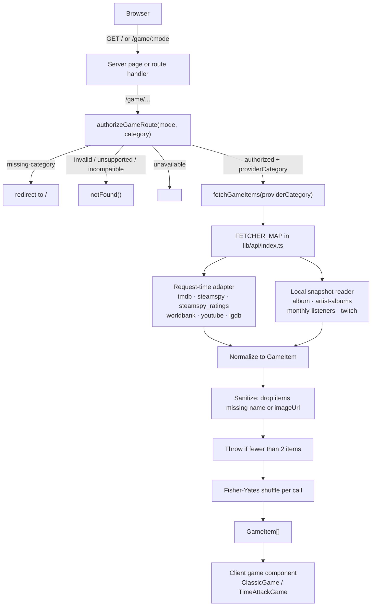

# Codebase Architecture

How a request becomes a playable deck: routing, catalog gating, provider
dispatch, normalization, and where client state lives. Facts below were read
from source on 2026-11-22. Counts marked *measured* came from reading the
committed JSON files directly; other uncertain items are labelled
`Needs Verification`.

---

## 1. Overview

HigherLower is a **Next.js App Router** app with three layers:

1. **Catalog** — a provider-independent semantic catalog plus an availability
   record per category. This decides what Home shows and which categories may
   launch gameplay.
2. **Data** — a single dispatcher maps an authorized category to either a
   request-time provider adapter or a local snapshot reader, then sanitizes,
   enforces a minimum pool size, and shuffles.
3. **Presentation** — server routes hand a normalized `GameItem[]` to client
   game components, which own the round loop, timers, keyboard input, and
   browser-storage persistence.



---

## 2. Folder structure

```text
app/
  layout.tsx                 Root layout: Space Mono, AtmosphereBackdrop, AudioSurface
  page.tsx                   Home (server component) -> HomeSetup
  globals.css                Tailwind v4 entry + design tokens
  game/
    layout.tsx               Shared /game/* wrapper
    [mode]/page.tsx          Mode dispatcher: authorize, then fetch
    classic/page.tsx         Concrete Classic route
    time-attack/page.tsx     Concrete Time Attack route
  api/
    test-fetch/route.ts      Dev-only diagnostic + snapshot-generation endpoint
components/
  atmosphere/AtmosphereBackdrop.tsx
  audio/AudioSurface.tsx
  home/{HomeSetup,DomainSelector,CategorySelector,LaunchDock}.tsx
  game/{GameplayShell,ComparisonBoard,DecisionControls,GameplayStatus,
        GameplayDivider,DerivedGameState,GameplayEntrance,GameCard,
        ClassicGame,TimeAttackGame}.tsx
  CategoryCard.tsx  ModeButton.tsx  HighScoresModal.tsx
  ui/button.tsx              shadcn/ui primitive
lib/
  api/                       Dispatcher, adapters, snapshot readers, data/
  atmosphere/                Canvas engine, sprites, delegation, event bus, types
  audio/                     audioEngine, settings, soundMap
  catalog/                   semanticCatalog, availability, routeAuthorization
  game/deck.ts               Shared pure deck helpers
  highScores/{storage,types}.ts
  home/selection.ts          Home selection persistence
types/
  api.ts                     GameItem, ApiFetchError
  game.ts                    CategoryId, modes, legacy category metadata
  view-transition.d.ts
scripts/                     Developer-run generators/enrichment (.mjs)
public/                      Static assets (e.g. twitch-generic.svg)
design-reference/            Target-design evidence: screens/, components/,
                             tokens/, notes/, manifest.json
docs/                        This documentation set + archived task artifacts
```

---

## 3. Routing model

| File | Kind | Behaviour |
| --- | --- | --- |
| [`app/layout.tsx`](../app/layout.tsx:32) | Root layout (server) | Loads Space Mono, mounts `<AtmosphereBackdrop />` and the headless `<AudioSurface />` around `children` ([`app/layout.tsx`](../app/layout.tsx:40)). |
| [`app/page.tsx`](../app/page.tsx:5) | **Server component** | Calls `getProductionCatalogProjection()` and renders `<HomeSetup catalog={...} />` inside `ViewTransition` ([`app/page.tsx`](../app/page.tsx:6)). |
| [`app/game/layout.tsx`](../app/game/layout.tsx:12) | Layout (server) | Transparent flex wrapper so the fixed atmosphere canvas paints below the game surface. |
| [`app/game/[mode]/page.tsx`](../app/game/[mode]/page.tsx:16) | Server page | Awaits `params`/`searchParams`, runs `authorizeGameRoute(mode, sp.category)`, then fetches and renders the mode component. |
| [`app/game/classic/page.tsx`](../app/game/classic/page.tsx:9) | Server page | Same authorize-then-fetch flow pinned to `classic`. |
| [`app/game/time-attack/page.tsx`](../app/game/time-attack/page.tsx:53) | Server page | Same flow pinned to `time-attack`. |
| [`app/api/test-fetch/route.ts`](../app/api/test-fetch/route.ts:41) | Route handler | Dev diagnostic; `?full=1` returns the full unshuffled pool and 404s in production. |

`/game/[mode]` fail-closed outcomes ([`app/game/[mode]/page.tsx`](../app/game/[mode]/page.tsx:21)):

- `missing-category` → `redirect("/")`
- `invalid-category`, `unsupported-mode`, `incompatible-mode` → `notFound()`
- `unavailable` → `<DerivedGameState kind="unavailable" />`
- fetch throws → `<DerivedGameState kind="error" />`; fewer than 2 items →
  `<DerivedGameState kind="empty" />`

> **Observation, not a correction.** `app/page.tsx` is a server component that
> renders the client component `HomeSetup` ([`components/home/HomeSetup.tsx`](../components/home/HomeSetup.tsx:1)
> starts with `"use client"`). Some older governance documents describe
> `app/page.tsx` itself as a client boundary; source says otherwise. This guide
> follows source and leaves governance files untouched.

---

## 4. Catalog layers

Three files, in dependency order:

1. **`lib/catalog/semanticCatalog.ts`** — the semantic product catalog.
   - Four domains: `movies-series`, `gaming`, `music`, `social-media`
     ([`lib/catalog/semanticCatalog.ts`](../lib/catalog/semanticCatalog.ts:45)).
   - Eleven categories with `compatibleModes` (`classic` and
     `time-attack` for every entry today)
     ([`lib/catalog/semanticCatalog.ts`](../lib/catalog/semanticCatalog.ts:73)).
   - Category ids are deliberately provider-independent.

2. **`lib/catalog/availability.ts`** — release gating.
   - Seven named release gates per category
     ([`lib/catalog/availability.ts`](../lib/catalog/availability.ts:18)) and one
     `productionPlayable` boolean that is an explicit release decision
     ([`lib/catalog/availability.ts`](../lib/catalog/availability.ts:67)).
   - `assertAvailabilityConsistency()` throws if a category is marked
     `productionPlayable` while any gate is unsatisfied
     ([`lib/catalog/availability.ts`](../lib/catalog/availability.ts:340)); it
     runs on every `getProductionCatalogProjection()` call
     ([`lib/catalog/availability.ts`](../lib/catalog/availability.ts:360)).
   - Home visibility is separate from playability: every semantic category is
     projected to Home, with a `playable` flag
     ([`lib/catalog/availability.ts`](../lib/catalog/availability.ts:288)).
   - As read on 2026-11-22, **all eleven categories have
     `productionPlayable: true`**, while the descriptive `status` labels vary
     (`movie-series-rating`, `release-date`, `gross-revenue`, `player-count`,
     `game-release-date`, `number-of-albums`, `album-release-date`,
     `youtube-subscribers` are `blocked`; `game-rating` is
     `runtime-verification-needed`; `monthly-listeners` and `twitch-followers`
     are `released`) ([`lib/catalog/availability.ts`](../lib/catalog/availability.ts:121)).
     The `status` label is descriptive and does not gate routes.
   - `resolveProviderCategory()` maps a semantic id to an internal provider
     dispatch key ([`lib/catalog/availability.ts`](../lib/catalog/availability.ts:425)).

3. **`lib/catalog/routeAuthorization.ts`** — the single fail-closed guard
   ([`lib/catalog/routeAuthorization.ts`](../lib/catalog/routeAuthorization.ts:49)).
   It validates the mode, rejects missing/ambiguous categories, rejects legacy
   ids, checks `compatibleModes`, requires `productionPlayable`, and finally
   requires a provider mapping
   ([`lib/catalog/routeAuthorization.ts`](../lib/catalog/routeAuthorization.ts:90)).
   Legacy ids rejected explicitly: `movie-ratings`, `game-playerbase`,
   `game-ratings`, `country-populations`
   ([`lib/catalog/routeAuthorization.ts`](../lib/catalog/routeAuthorization.ts:38)).

### Semantic → provider mapping

| Semantic category | Provider dispatch key |
| --- | --- |
| `movie-series-rating` | `movie-ratings` |
| `game-rating` | `game-ratings` |
| `player-count` | `game-playerbase` |
| `release-date` | `release-dates` |
| `gross-revenue` | `movie-gross-revenue` |
| `number-of-albums` | `artist-album-counts` |
| `album-release-date` | `album-release-dates` |
| `youtube-subscribers` | `youtube-subscribers` |
| `game-release-date` | `game-release-dates` |
| `monthly-listeners` | `monthly-listeners` |
| `twitch-followers` | `twitch-followers` |

Source: [`lib/catalog/availability.ts`](../lib/catalog/availability.ts:393).

---

## 5. Data layer

### 5.1 Dispatcher

[`lib/api/index.ts`](../lib/api/index.ts:41) is the only entry point UI code
uses. `fetchGameItems()` = `fetchGameItemsRaw()` + Fisher-Yates shuffle
([`lib/api/index.ts`](../lib/api/index.ts:78)); `fetchGameItemsRaw()` resolves
`FETCHER_MAP`, filters out items missing `name` or `imageUrl`, and throws when
fewer than 2 survive ([`lib/api/index.ts`](../lib/api/index.ts:96)).

### 5.2 Request-time adapters

| Provider key | Module | External dependency | Env |
| --- | --- | --- | --- |
| `movie-ratings`, `release-dates`, `movie-gross-revenue` | [`lib/api/tmdb.ts`](../lib/api/tmdb.ts:1) | TMDB | `TMDB_API_KEY` |
| `game-playerbase` | [`lib/api/steamspy.ts`](../lib/api/steamspy.ts:1) | SteamSpy (keyless) | — |
| `game-ratings` | [`lib/api/steamspy_ratings.ts`](../lib/api/steamspy_ratings.ts:1) | Steam reviews (keyless) | — |
| `country-populations` | [`lib/api/worldbank.ts`](../lib/api/worldbank.ts:1) | World Bank (keyless) | — |
| `youtube-subscribers` | [`lib/api/youtube.ts`](../lib/api/youtube.ts:1) | YouTube Data API | `YOUTUBE_API_KEY` |
| `game-release-dates` | [`lib/api/igdb.ts`](../lib/api/igdb.ts:1) | IGDB via Twitch OAuth | `TWITCH_CLIENT_ID`, `TWITCH_CLIENT_SECRET` |

`country-populations` is still in `FETCHER_MAP`
([`lib/api/index.ts`](../lib/api/index.ts:45)) but its legacy id is rejected by
route authorization, so no current route reaches it.

### 5.3 Local snapshot readers

| Provider key | Module | Reads |
| --- | --- | --- |
| `album-release-dates` | [`lib/api/albumReleaseDateSnapshot.ts`](../lib/api/albumReleaseDateSnapshot.ts:29) | `lib/api/data/album-release-date.snapshot.json` |
| `artist-album-counts` | [`lib/api/artistAlbumCountsSnapshot.ts`](../lib/api/artistAlbumCountsSnapshot.ts:1) | `lib/api/data/artist-album-counts.snapshot.json` |
| `monthly-listeners` | [`lib/api/monthlyListenersSnapshot.ts`](../lib/api/monthlyListenersSnapshot.ts:7) | `lib/api/data/monthly-listeners.snapshot.json` |
| `twitch-followers` | [`lib/api/twitchFollowersSnapshot.ts`](../lib/api/twitchFollowersSnapshot.ts:7) | `twitch-followers-metrika.snapshot.json` joined to `twitch-owner-review-roster.json`, with `twitch-avatar-images.json` for avatars |

These readers use `node:fs` only and make **no request-time network calls**
([`lib/api/monthlyListenersSnapshot.ts`](../lib/api/monthlyListenersSnapshot.ts:1),
[`lib/api/twitchFollowersSnapshot.ts`](../lib/api/twitchFollowersSnapshot.ts:1)).
They fail closed with `ApiFetchError` on a malformed or too-small snapshot.

Measured committed pool sizes (read from the JSON files on 2026-11-22):

| Snapshot file | `items` length | `generatedAt` |
| --- | --- | --- |
| `album-release-date.snapshot.json` | 220 | 2026-10-15 |
| `artist-album-counts.snapshot.json` | 251 | 2026-10-14 |
| `monthly-listeners.snapshot.json` | 236 | 2026-11-02 |
| `twitch-followers-metrika.snapshot.json` | not an `items` array (metrics map) | 2026-11-02 |

The gate-evidence strings inside
[`lib/catalog/availability.ts`](../lib/catalog/availability.ts:121) still cite
older pool sizes (for example 17 for artist album counts and 120 for album
release dates) from the dates when those gates were signed off. The measured
file sizes above are the current truth; the evidence strings are historical
prose, not live counts. `Needs Verification [inferred-from-codebase]`: whether
the gate evidence should be refreshed to match the current files is a
documentation decision, not a code change.

### 5.4 Present but inactive

`lib/api/rawg.ts`, `lib/api/cheapshark.ts`, and `lib/api/fakestoreapi.ts` exist
but are **not** imported by `FETCHER_MAP` ([`lib/api/index.ts`](../lib/api/index.ts:41)),
so they are unreachable from any route.

### 5.5 Normalized contract

[`types/api.ts`](../types/api.ts:6) defines the only shape the game engine sees:

```ts
GameItem { id, name, imageUrl, value, displayValue, attribution? }
```

`ApiFetchError` carries `source` and `statusCode`
([`types/api.ts`](../types/api.ts:28)). Raw provider payloads never escape their
adapter module.

---

## 6. Client state and persistence

There is no global client store and no server-side session. Each client
component owns local state; durable state lives in `localStorage` under
versioned keys.

| Concern | Module | Storage key | Notes |
| --- | --- | --- | --- |
| High scores | [`lib/highScores/storage.ts`](../lib/highScores/storage.ts:12), [`lib/highScores/types.ts`](../lib/highScores/types.ts:1) | `higherlower.highscores.v1` (plus `higherlower.highscores.migration.v1`) | One versioned envelope keyed by mode + category; legacy keys (`hl-highscore-classic-`, `time_attack_highscore_`) are migrated ([`lib/highScores/storage.ts`](../lib/highScores/storage.ts:16)). |
| Home selection | [`lib/home/selection.ts`](../lib/home/selection.ts:26) | `hl:setup:v1` | Domain/category/mode triple; restored in a passive effect after hydration. |
| Audio settings | [`lib/audio/settings.ts`](../lib/audio/settings.ts:15) | `hl:audio:v1` | `{ sfx, ticks, muted }`; read through `useSyncExternalStore`. |

Both game modes write through the same store:
[`components/game/ClassicGame.tsx`](../components/game/ClassicGame.tsx:126)
uses `mode: "classic"` and
[`components/game/TimeAttackGame.tsx`](../components/game/TimeAttackGame.tsx:157)
uses `mode: "time-attack"`, while
[`components/HighScoresModal.tsx`](../components/HighScoresModal.tsx:108)
calls `migrateLegacyHighScores()` and lists both modes.

> **Recorded fact.** Older governance notes describe Classic and Time Attack as
> writing separate high-score namespaces. In current source they share one
> versioned key; the split survives only as legacy-migration prefixes
> ([`lib/highScores/storage.ts`](../lib/highScores/storage.ts:16)). Treated here
> as an observation only — no behaviour change is proposed.

Browser APIs (storage, timers, keyboard listeners) belong to the client
components listed in §7; server components never touch them.

---

## 7. Presentation and shell

**Gameplay** (`components/game/`):

- [`GameplayShell.tsx`](../components/game/GameplayShell.tsx:1) — outer gameplay frame.
- [`ComparisonBoard.tsx`](../components/game/ComparisonBoard.tsx:1) — the two-card comparison surface.
- [`DecisionControls.tsx`](../components/game/DecisionControls.tsx:1) — Higher/Lower actions.
- [`GameplayStatus.tsx`](../components/game/GameplayStatus.tsx:1) — score/timer readouts.
- [`GameplayDivider.tsx`](../components/game/GameplayDivider.tsx:1) — centre divider.
- [`DerivedGameState.tsx`](../components/game/DerivedGameState.tsx:1) — `unavailable` / `error` / `empty` states.
- [`GameplayEntrance.tsx`](../components/game/GameplayEntrance.tsx:1) — entrance sequencing.
- [`GameCard.tsx`](../components/game/GameCard.tsx:1) — single card with native ``.
- [`ClassicGame.tsx`](../components/game/ClassicGame.tsx:1) and
  [`TimeAttackGame.tsx`](../components/game/TimeAttackGame.tsx:1) — mode
  containers owning round state, timers, keyboard input, and score writes.

**Home** (`components/home/`):

- [`HomeSetup.tsx`](../components/home/HomeSetup.tsx:1) — client Home orchestrator.
- [`DomainSelector.tsx`](../components/home/DomainSelector.tsx:1) — four-domain picker.
- [`CategorySelector.tsx`](../components/home/CategorySelector.tsx:1) — category cards for the chosen domain.
- [`LaunchDock.tsx`](../components/home/LaunchDock.tsx:1) — sticky launch dock.

**Shared UI**:

- [`components/CategoryCard.tsx`](../components/CategoryCard.tsx:1), [`components/ModeButton.tsx`](../components/ModeButton.tsx:1), [`components/HighScoresModal.tsx`](../components/HighScoresModal.tsx:1).
- [`components/ui/button.tsx`](../components/ui/button.tsx:1) — shadcn/ui primitive.

**Persistent shell**:

- [`components/atmosphere/AtmosphereBackdrop.tsx`](../components/atmosphere/AtmosphereBackdrop.tsx:1) — mounts the single atmosphere canvas; engine in `lib/atmosphere/`.
- [`components/audio/AudioSurface.tsx`](../components/audio/AudioSurface.tsx:1) — headless global audio owner plus the Home-only control.

Shared pure deck logic lives in [`lib/game/deck.ts`](../lib/game/deck.ts:1).

---

## 8. Generated data and generators

Generated artifacts live in `lib/api/data/` (snapshots, the Spotify identity
catalog, the YouTube channel catalog, and the Twitch roster / avatar artifacts).
They are produced by developer-run scripts in `scripts/` and committed, so
gameplay never performs the slow provider crawl.

| Artifact | Generator |
| --- | --- |
| `album-release-date.snapshot.json` | `npm run snapshot:album-release-date` |
| `artist-album-counts.snapshot.json` | `npm run snapshot:artist-album-counts` |
| `youtube-channel-catalog.json` | `npm run catalog:youtube-channels` |
| `monthly-listeners.snapshot.json` | `npm run snapshot:monthly-listeners` |
| `twitch-followers-metrika.snapshot.json` | `npm run snapshot:twitch-followers` |
| `music-spotify-identities.json` | `scripts/generate-music-spotify-identity-catalog.mjs` (direct `node`) |
| `twitch-avatar-images.json` | `scripts/enrich-twitch-profile-images.mjs` (direct `node`, offline) |

Environment requirements, quota cautions, and safe-run procedure are covered in
[`04-api-data-and-operations.md`](04-api-data-and-operations.md).

---

## Open questions / Needs Verification

- **Snapshot staleness policy.** Readers warn past an age threshold but apply no
  hard cutoff, so committed snapshots continue to be served.
  `Needs Verification [product-decision]`.
- **Gate-evidence drift.** `availability.ts` evidence strings cite older pool
  sizes than the committed JSON files. Whether to refresh the prose is a
  documentation decision. `Needs Verification [inferred-from-codebase]`.
- **Twitch runtime pool size.** The reader joins the metrics snapshot to the
  approved roster; the resulting playable count was not measured here.
  `Needs Verification [inferred-from-codebase]`.
- **Governance description of `app/page.tsx`.** Governance text and source
  disagree about whether Home is a client boundary; source is authoritative and
  governance was left unedited. `Needs Verification [inferred-from-codebase]`.
- **High-score namespace history.** Governance records a Classic/Time Attack
  split that is not present in current source. Intent behind the older note is
  unresolved. `Needs Verification [product-decision]`.
- **Guides 03 and 04.** Referenced above but not yet present in `docs/`.
  `Needs Verification [inferred-from-codebase]`.
