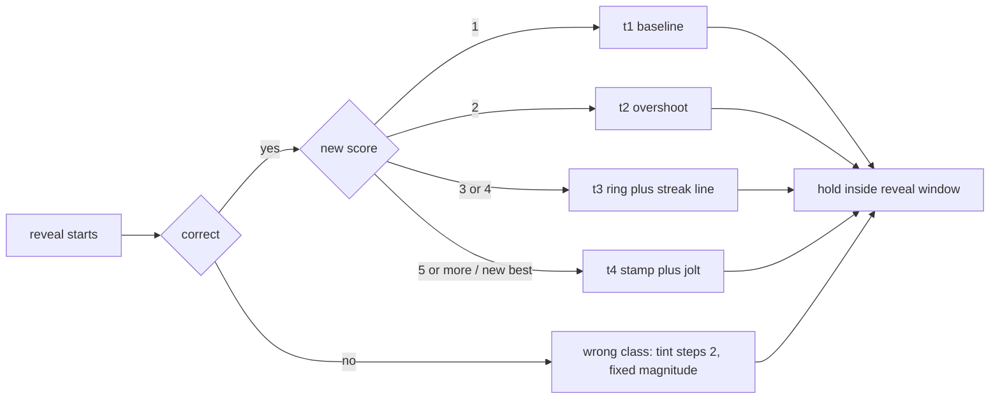
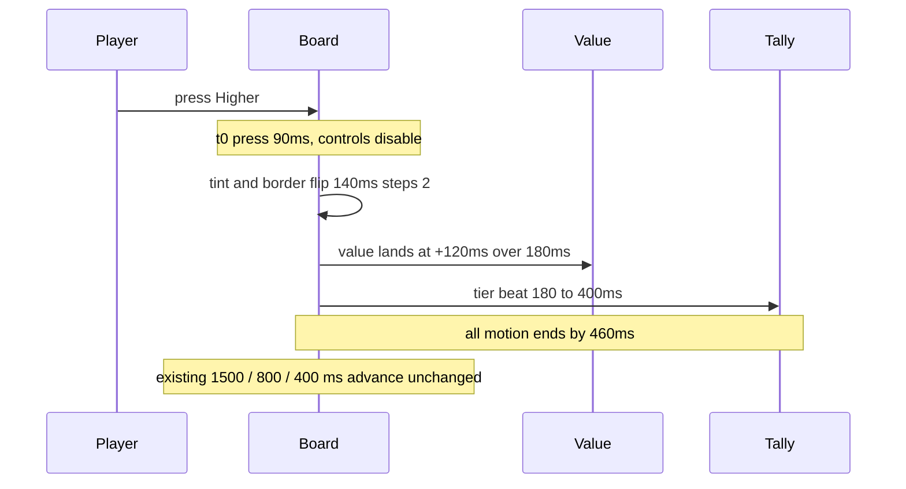

# Immersive Motion Enhancement — Design

**Date:** 2026-11-22
**Stage:** Design only (no code changes)
**Task type:** Visual change + interaction enhancement (motion layer) — *refinement preserves*, not redesign replaces
**Status:** Design complete. Plan stage next. Code stage not started.
**Upstream:** [`docs/immersive-motion-redesign-analysis-2026-11-22.md`](immersive-motion-redesign-analysis-2026-11-22.md)

---

## 0. Stage inputs, tooling status, and what this document is not

### 0.1 Inputs read for this stage

| Input | Purpose | Evidence |
|---|---|---|
| Analysis document, all sections including §4.5 runtime verification and §4.6 product decisions | Incumbent truth, measured values, allowlist | [`docs/immersive-motion-redesign-analysis-2026-11-22.md`](immersive-motion-redesign-analysis-2026-11-22.md:1) |
| `design-reference/` tokens and notes | Authoritative incumbent visual evidence | [`design-reference/tokens/visual-patterns.md`](../design-reference/tokens/visual-patterns.md:1), [`design-reference/tokens/foundational-components.md`](../design-reference/tokens/foundational-components.md:1), [`design-reference/tokens/layout.md`](../design-reference/tokens/layout.md:1), [`design-reference/manifest.json`](../design-reference/manifest.json:1) |
| `.roo/rules/00-governance.md`, `02-workflow.md`, `03-evidence-and-verification.md`, `ui-design-system.md`, `governance/conditions/design.md`, `governance/conditions/plan.md` | Governing policy for this stage | `.roo/rules/` |
| `app/globals.css` | Tokens, existing keyframes, reduced-motion block | [`app/globals.css`](../app/globals.css:1) |
| `package.json` | Motion `^14.1.0`, Next `16.3.4`, React `19.2.8` | [`package.json`](../package.json:14) |
| Next.js 16 local docs, view transitions | Framework API and CSS requirements | [`node_modules/next/dist/docs/01-app/02-guides/view-transitions.md`](../node_modules/next/dist/docs/01-app/02-guides/view-transitions.md:1) |
| Next.js 16 local docs, `useRouter` / `Link` | `transitionTypes` API shape | [`node_modules/next/dist/docs/01-app/03-api-reference/04-functions/use-router.md`](../node_modules/next/dist/docs/01-app/03-api-reference/04-functions/use-router.md:44), [`node_modules/next/dist/docs/01-app/03-api-reference/02-components/link.md`](../node_modules/next/dist/docs/01-app/03-api-reference/02-components/link.md:505) |
| Impeccable skill + `reference/animate.md` playbook | Design discipline, motion thesis, timing/easing rules | `.agents/skills/impeccable/SKILL.md`, [`.agents/skills/impeccable/reference/animate.md`](../.agents/skills/impeccable/reference/animate.md:1) |
| `animate` playbook (Emil Kowalski construction rules) | Gate / tool / property / curve / never-ship rules | [`.agents/skills/animate/SKILL.md`](../.agents/skills/animate/SKILL.md:1) |

### 0.2 Tooling status for this stage

| Capability | Status | Detail |
|---|---|---|
| `impeccable context` launcher | `[Blocked]` — not executable here | This session's Architect toolset has no command-execution tool, so `.agents/skills/impeccable/scripts/impeccable context` could not be run. **Context loading did not run; I read the existing project context directly.** Per the skill's failure path, existing project context was read without inventing missing context. The analysis already ran the launcher on 2026-11-22 and recorded its directives: `NO_PRODUCT_MD`, `SCOPED_EXISTING_ALLOWED`, `EXISTING_VISUAL_SYSTEM`, `MANUAL_DETECTOR_REQUIRED`, `ACCOUNT: not signed in` ([`docs/immersive-motion-redesign-analysis-2026-11-22.md`](immersive-motion-redesign-analysis-2026-11-22.md:174)). Those directives are treated as current. |
| `reference/craft-floor.md` | Deliberately not loaded | Planning-only stage; the skill directs loading the craft floor immediately before a UI edit, not before planning. |
| Browser / Playwright / animation-inspector | Not used this stage | Design is source-and-evidence based; runtime verification belongs to QA. Analysis second-pass measurements are used as the runtime baseline. |

### 0.3 What this document is not

- It is **not** a layout change, theme change, copy change, or gameplay change.
- It is **not** a replacement visual world. It adds a motion layer inside the incumbent identity.
- It does **not** resolve or pre-empt any owner product decision listed in the binding decision log (§1.1).
- It does **not** contain effort estimates.

---

## 1. Authority and scope

### 1.1 Owner-approved decisions (binding, recorded verbatim)

| # | Decision (verbatim) |
|---|---|
| 1 | Route-level `<ViewTransition>` on Home → gameplay: **YES**. |
| 2 | Outcome intensity: **streak-escalating five-tier intensity**. |
| 3 | Ambient motion: **max two loops, Home only, sub-8px, ≥2s; none in gameplay**. |
| 4 | Reduced motion: **preserve opacity crossfades, drop positional movement** (this is net-new work; current runtime hard-strips). |
| 5 | Game-over entrance: **keep the current in-place fade/scale** (no heavier drop). |
| 6 | Mobile: **layout untouched** — no sticky bar; decision controls remain 256–322px below the fold at 390×844. Record this as an accepted UX tradeoff, not a defect to fix. |

Decision 6 is recorded here as an **accepted UX tradeoff**. It is not a defect, not a backlog item created by this task, and nothing in this design moves content, adds sticky chrome, or nudges scroll.

### 1.2 Authority order used in this design

1. The six owner decisions above.
2. `.roo/rules/` always-on policy, including `ui-design-system.md` theme preservation.
3. Incumbent implementation and `design-reference/` evidence.
4. The analysis document's measured runtime values.
5. Reference-site motion **principles** (never their visual worlds).

### 1.3 Scope boundaries

**In scope:** a transform/opacity motion layer on two existing surfaces (Home setup, Gameplay), plus one route-level transition, plus a reduced-motion fidelity upgrade.

**Out of scope, explicitly:**

- Layout, spacing, breakpoints, sticky chrome, scroll behaviour, section order.
- Palette, typography (Space Mono stays), offset-shadow language, border weights, radii.
- Copy, labels, live-region wording.
- Gameplay rules, scoring, deck logic, timing constants (`1500 ms`, `800 ms`, `400 ms`, `1000 ms`, `460 ms`), provider adapters, catalog authorization, storage semantics.
- Dependency changes. Motion `14.1.0` is already installed and is the only motion runtime used.
- Converting `components/game/GameCard.tsx` native `` to a framework image component.
- Deleting or consolidating legacy unused CSS utilities (recorded in §3.7, not acted on).

### 1.4 Reference principles adopted (principles, not copies)

| Principle | Source evidence | How it lands here |
|---|---|---|
| Motion is event-driven and short for feedback, slow and low-amplitude for ambience | krillion 11 ambient loops vs 0.1–0.65 s feedback ([analysis §4.1](immersive-motion-redesign-analysis-2026-11-22.md:198)); fairways `rise` 0.6 s vs `popin` 0.45 s ([analysis §4.3](immersive-motion-redesign-analysis-2026-11-22.md:274)) | All event feedback ≤ 240 ms; ambience ≥ 2.4 s |
| Stepped easing is deliberate, not a performance hack | krillion `transform 0.1s steps(2)` on 10 controls; fairways `steps(4)`/`steps(6)` ([analysis §4.1](immersive-motion-redesign-analysis-2026-11-22.md:218), [§4.3](immersive-motion-redesign-analysis-2026-11-22.md:291)) | `steps(2)` on tint/border state flips only — never on movement |
| Feedback is sequenced: primary first, explanation second | fairways `.st-sub` `rise 0.35s ease-out 0.25s both` ([analysis §4.3](immersive-motion-redesign-analysis-2026-11-22.md:283)) | Card plate reacts, value lands 120 ms later |
| Intensity scales with outcome quality | fairways `t0 thud → t4 slam+jolt`, `t4` alone adds sustained secondary motion ([analysis §4.3](immersive-motion-redesign-analysis-2026-11-22.md:291)) | Five-tier ladder, §4 |
| One dominant action per state | fairways dock with a single `SWING` button ([analysis §4.3](immersive-motion-redesign-analysis-2026-11-22.md:287)) | Decision controls are the only animated interactive element during reveal |
| Explicit reduced-motion neutralisation | all three references ship it ([analysis §4.4](immersive-motion-redesign-analysis-2026-11-22.md:306)) | Preserved and refined, §7 |
| None of the three depends on bespoke route transition machinery | krillion ships only the default `root` name ([analysis §4.4](immersive-motion-redesign-analysis-2026-11-22.md:307)) | Route motion is deliberately minimal (§6.2), not a showcase |

---

## 2. Surface modes

Mode names follow the Impeccable skill's mode vocabulary. Modes are chosen per **surface**, not per product.

| Surface | Mode | Justification |
|---|---|---|
| Home / setup | **Persuade** | The visitor decides and acts: pick domain, pick category, pick mode, press `go!`. Motion may carry voice here. This is the only surface that earns ambient life. |
| Gameplay (Classic + Time Attack) | **Experience** | The visitor is inside the work: the comparison board *is* the artifact, and the interface is supposed to recede. Not *Operate*: the player is not completing a task, they are watching a reveal that answers a question they just asked. Evidence for the Experience reading: fairways' gameplay reduces to one dominant action with chrome dimmed during the decisive beat ([analysis §4.3](immersive-motion-redesign-analysis-2026-11-22.md:287), [§4.4](immersive-motion-redesign-analysis-2026-11-22.md:305)), which is exactly a "let the artifact lead" posture. The Operate traits that *do* apply (scanability, consistency, live regions) are served as constraints in §7, not as the mode. |
| High Scores modal / game-over panel | **Operate** | System state with focus management. Fast, symmetric, predictable. No authored choreography beyond a bounded cascade. |

**Motion ambition per mode.** Persuade gets the voice (one authored focal sequence on entry, two ambient loops, selection physics). Experience gets precision (feedback and continuity only, zero ambience). Operate gets restraint (200 ms in/out, no spatial novelty).

### 2.1 Motion thesis (per the `animate` playbook)

- **Focal moment:** the reveal beat. The card plate reacts first, the value lands second, and the magnitude of that beat is a function of how well the run is going. This comes from higher/lower's own concept — the whole game is one repeated question with one repeatedly-revealed answer — not from a generic fade-and-rise.
- **Continuity:** two handoffs. Home → board (route), and *next card → current card* (in-round). Both must read as the same object moving, not two objects swapping.
- **Feedback:** decision press, score tally, streak escalation, timer urgency.
- **Budget:** transform/opacity only. ≤ 2 ambient loops (Home only). ≤ 2 concurrent event animations in any beat. Zero new dependencies. No new `requestAnimationFrame` loops.

---

## 3. Motion system tokens

### 3.1 Additive-only rule

New tokens are declared in a **second `:root` block appended after the existing one**. No existing declaration in [`app/globals.css`](../app/globals.css:4) is edited, renamed, reordered, or removed. The reduced-motion block at [`app/globals.css`](../app/globals.css:188) stays byte-identical.

### 3.2 Durations

| Token | Value | Use |
|---|---|---|
| `--motion-dur-tap` | `90ms` | press acknowledgement (replaces the current 150 ms default for press) |
| `--motion-dur-quick` | `140ms` | hover settle, tint/border flips, route exit |
| `--motion-dur-base` | `180ms` | routine state change; matches the incumbent dialog 200 ms and category swap 180 ms |
| `--motion-dur-beat` | `240ms` | the primary reveal beat (card plate, card handoff) |
| `--motion-dur-accent` | `400ms` | max duration of any one-shot accent (ring, brief shake) |
| `--motion-dur-route` | `320ms` | route transition total (docs cap: keep short, `view-transitions.md:370`) |
| `--motion-dur-ambient` | `2400ms` | ambient loop A |
| `--motion-dur-ambient-slow` | `3200ms` | ambient loop B |
| `--motion-dur-timer` | `1000ms` | unchanged timer bar tick (documents the existing value, does not change it) |

### 3.3 Easings

| Token | Value | Provenance |
|---|---|---|
| `--motion-ease-out` | `cubic-bezier(0.23, 1, 0.32, 1)` | Already the incumbent curve for hero, dialog and category swap ([`app/globals.css`](../app/globals.css:135), [`components/home/HomeSetup.tsx`](../components/home/HomeSetup.tsx:142)); the playbook's strong UI ease-out |
| `--motion-ease-in-out` | `cubic-bezier(0.77, 0, 0.175, 1)` | Playbook curve for on-screen movement (card handoff) |
| `--motion-ease-overshoot` | `cubic-bezier(0.34, 1.56, 0.64, 1)` | Measured on krillion `.ds-begin-btn` ([analysis §4.1](immersive-motion-redesign-analysis-2026-11-22.md:218)); noillirk `hr-pop` overshoots too ([analysis §4.2](immersive-motion-redesign-analysis-2026-11-22.md:256)) |
| `--motion-ease-slam` | `cubic-bezier(0.2, 1.8, 0.4, 1)` | Measured fairways `t4` `slam` ([analysis §4.3](immersive-motion-redesign-analysis-2026-11-22.md:291)) |
| `--motion-ease-step-2` | `steps(2, end)` | Measured krillion stepped controls ([analysis §4.1](immersive-motion-redesign-analysis-2026-11-22.md:218)) |
| `--motion-ease-linear` | `linear` | Timer bar (existing `ease-linear`, [`components/game/TimeAttackGame.tsx`](../components/game/TimeAttackGame.tsx:378)) |

`ease-in` is not in the token set and must not appear in new UI motion.

### 3.4 Distances and scale

| Token | Value | Use |
|---|---|---|
| `--motion-dist-nudge` | `2px` | tick-level emphasis |
| `--motion-dist-lift` | `4px` | existing hover lift ([`components/game/DecisionControls.tsx`](../components/game/DecisionControls.tsx:25)) |
| `--motion-dist-rise` | `8px` | existing hero child rise ([`components/home/HomeSetup.tsx`](../components/home/HomeSetup.tsx:138)) |
| `--motion-dist-handoff` | `10px` | card enter along the compare axis |
| `--motion-dist-value` | `6px` | value-block land |
| `--motion-dist-ambient` | `4px` | ambient loop excursion (budget: sub-8px) |
| `--motion-scale-press` | `0.985` | pressed control |
| `--motion-scale-enter` | `0.97` | never lower; `scale(0)` is banned |
| `--motion-scale-pop` | `1.06` | score tally bump |
| `--motion-scale-slam` | `1.12` | t4 milestone stamp (not on the card image; on the tally) |

All excursions are ≤ 10 px so they cannot introduce horizontal overflow at 390 px, where the gameplay document is 1252 px tall with `overflow-x-hidden` ([`components/game/GameplayShell.tsx`](../components/game/GameplayShell.tsx:45)).

### 3.5 Delay and stagger

| Token | Value | Use |
|---|---|---|
| `--motion-delay-value` | `120ms` | value lands after the plate |
| `--motion-delay-secondary` | `120ms` | streak line trails the status text |
| `--motion-stagger-item` | `32ms` | list cascade |
| `--motion-stagger-cap` | `6` | maximum staggered items; item 7+ appears with item 6 |

### 3.6 Keyframe reuse ledger (answers analysis open question 8)

The analysis flagged that 12 keyframes exist but are unused, and asked Design to decide reuse-versus-ignore explicitly rather than leave two parallel vocabularies ([analysis §8 item 8](immersive-motion-redesign-analysis-2026-11-22.md:444)).

| Existing keyframe / class | Decision | Reason |
|---|---|---|
| `timer-urgent` ([`app/globals.css`](../app/globals.css:425)) | **Reuse as-is** | Exactly the right beat for the ≤10 s urgency state; owner's analysis already identified it. 600 ms cycle ≈ 1.67 Hz, below the 3 Hz flash ceiling. |
| `shake` ([`app/globals.css`](../app/globals.css:394)) | **Reuse keyframe, add `--motion-dur-*`-scaled class** | Time Attack already uses `.shake` at 450 ms inside a 460 ms window; Classic needs a shorter variant. Reusing the keyframe keeps one shake vocabulary. |
| `pulse-ring` ([`app/globals.css`](../app/globals.css:301)) | **Reuse keyframe, one iteration** | t3 streak ring; the existing 1.8 s infinite loop is not used. |
| `floatUp` ([`app/globals.css`](../app/globals.css:441)) | **Reuse keyframe, add duration variants** | The delta label must fit 400 ms (wrong) and 800 ms (correct); the current 900 ms class overshoots both. |
| `fadeInUp` ([`app/globals.css`](../app/globals.css:347)) | **Reuse for card handoff enter** | 12 px rise, 0.35 s default; a duration variant brings it to `--motion-dur-beat`. |
| `fadeInScale` ([`app/globals.css`](../app/globals.css:361)) | **Ignore** | A 0.94→1 mount scale reads as a modal entrance; not used on any surface in this design. |
| `orb-float` ([`app/globals.css`](../app/globals.css:376)) | **Explicitly reject** | 22 s loop plus `filter: blur(90px)` — animated blur is paint work, not compositor work. Rejecting it is what keeps the ambient budget honest. |
| `shimmer` ([`app/globals.css`](../app/globals.css:316)) | **Ignore** | Not a game state; no skeleton surfaces in scope. |
| `home-dialog-in` / `home-dialog-out` ([`app/globals.css`](../app/globals.css:124)) | **Keep, do not retime** | Already tuned at 200 ms and paired with a JS close delay that respects reduced motion ([`components/HighScoresModal.tsx`](../components/HighScoresModal.tsx:84)). |
| Legacy `.glass`, `.glass-hover`, `.btn-primary`, `.btn-gold`, `.text-gradient`, `.stripe-accent`, `.card-selected`, `.section-label` | **Ignore; do not delete** | Pre-redesign vocabulary, unused by the game surfaces. Removing them is cleanup, which is out of scope ([analysis open question 11](immersive-motion-redesign-analysis-2026-11-22.md:447)). |

New keyframes are added only where no existing one fits: `value-land`, `tally-bump`, `tier-stamp`, `ambient-drift` (the last is a 4 px translate loop, deliberately not `orb-float`).

### 3.7 Property policy

- Allowed: `transform`, `opacity`, `color`, `background-color`, `border-color`, `text-shadow` (state change only, never looped), `box-shadow` (state change only, never looped).
- Forbidden: `width`, `height`, `top`, `left`, `margin`, `padding`, `filter`, `backdrop-filter` in any new animation. The single existing exception is the `CategorySelector` height interpolation ([`components/home/CategorySelector.tsx`](../components/home/CategorySelector.tsx:65)); it stays as-is and no second height animation is added.
- No permanent `will-change`. No `transition: all` in new code.

---

## 4. Five-tier intensity ladder

### 4.1 Tier semantics

The ladder is the **reward** axis. Intensity is a monotonic function of how significant a correct answer is. It is derived only from state that already exists — `score`, `lastCorrect`/`tint` and the existing `phase` — with no new gameplay state, rule, or timing ([analysis §5 principle 2](immersive-motion-redesign-analysis-2026-11-22.md:364)).

| Tier | Higher/Lower meaning | Condition | Rationale |
|---|---|---|---|
| **t0** | Neutral acknowledgement | no outcome: hover, press, selection | Every surface needs a "heard you" beat that costs nothing |
| **t1** | Correct, baseline | first correct of the run | A correct answer always deserves legibility, never spectacle |
| **t2** | Correct, streak 2 | new score = 2 | The second correct is where a run starts to feel real |
| **t3** | Correct, streak ≥3 | new score ≥ 3 | Skill recognition: the first moment that earns an accent |
| **t4** | Milestone | new score ≥ 5, or a new personal best, or the final correct of a completed Classic run | The one moment worth an authored stamp |

**Wrong answer is a separate, off-ladder class (`wrong`), not a tier.** It sits at roughly t2 magnitude on the *intensity* axis but carries negative semantics and **never escalates**. Three reasons, all evidence-backed: (a) escalating punishment on repeated failure is a documented UX risk and the owner explicitly kept the game-over entrance restrained (decision 5); (b) all three references tier *rewards* — fairways' `t0..t4` are score stamps, not error states ([analysis §4.3](immersive-motion-redesign-analysis-2026-11-22.md:274)); (c) Time Attack's wrong path is only 400 ms long, which cannot host an escalating sequence without changing gameplay timing, which is forbidden. This placement is flagged `Needs Verification [product-decision]` in §10 in case the owner wants wrong answers inside the ladder.

### 4.2 Streak derivation (no gameplay changes)

A single pure helper shape — `resolveTier({ score, correct, isNewBest })` — read by both games:

- **Classic:** `score` *is* a streak, because a wrong answer ends the run ([`components/game/ClassicGame.tsx`](../components/game/ClassicGame.tsx:180)). t2 at `score === 2`, t3 at `score >= 3`, t4 at `score >= 5`.
- **Time Attack:** `score` is a cumulative correct count, because a wrong answer only removes time ([`components/game/TimeAttackGame.tsx`](../components/game/TimeAttackGame.tsx:239)). The same thresholds apply to the cumulative count.

Using one derived function keeps the two modes visually consistent without pretending Time Attack has a combo counter it does not have. Introducing a true Time Attack *consecutive-correct* counter would be new display state; that is flagged `Needs Verification [product-decision]` in §10 and **not** implemented here.

### 4.3 Tier table

| Tier | Purpose | Trigger | Properties | Duration | Easing | Distance / scale | Sequencing | Cooldown / guards |
|---|---|---|---|---|---|---|---|---|
| **t0** | Feedback | pointerdown / keydown on Higher or Lower; hover; selection change | `transform` | tap `90ms`, hover `140ms` | `--motion-ease-out` | lift `4px`, press `scale(0.985)` | single beat | never on `disabled`; `(hover: hover) and (pointer: fine)` gate for hover; no motion on keyboard repeat |
| **t1** | Feedback + state indication | reveal begins, correct | card tint + border `background-color`/`border-color`; value `opacity`+`transform`; tally `transform` | tint `140ms`, value `180ms` starting at `120ms`, tally `180ms` | tint `--motion-ease-step-2`, value `--motion-ease-out`, tally `--motion-ease-overshoot` | value `6px`→0, tally `1.06`→1 | plate → (120 ms) → value; tally overlaps | one beat per reveal; must end ≤ 460 ms (Classic budget 1500 ms, TA 800 ms) |
| **t2** | State indication | reveal, correct, new score 2 | t1 plus value arrival gains a `3%` overshoot and the tally uses `--motion-scale-pop` | value `180ms`, tally `200ms` | `--motion-ease-overshoot` | value `1.03`→1 | same as t1 | same as t1; no new colour |
| **t3** | Attention + reward | reveal, correct, new score ≥ 3 | t2 plus a one-shot accent ring on the tally chip and a secondary streak line | ring `400ms`, secondary line `180ms` at `+120ms` | ring `--motion-ease-out`, line `--motion-ease-out` | ring `1`→`1.9` fading to 0 | status text → (120 ms) → streak line → ring trails | ring runs once (`iteration-count: 1`); the secondary line appears **only** when a streak exists, so it never fabricates a signal |
| **t4** | Authored moment | reveal, correct, new score ≥ 5, or new personal best, or final correct of a Classic run | t3 plus a tally stamp and a single decaying jolt on the tally chip | stamp `240ms`, jolt `160ms` at `+160ms` | stamp `--motion-ease-slam`, jolt `--motion-ease-step-2` | stamp `1.12`→1, jolt `±2px` decaying | stamp → (160 ms) → jolt → ring trailing | at most one t4 per run unless a new best is beaten again; never fires on the game-over panel itself (decision 5) |
| **`wrong`** | State indication (negative) | reveal, incorrect | card tint + border (mechanical palette already present); status text; optional brief board jolt | tint `140ms`, jolt `240ms` (TA keeps its existing `450ms` `.shake` inside its `460ms` window) | tint `--motion-ease-step-2`, jolt `--motion-ease-out` | jolt `±3px` decaying to 0 | tint + status first; jolt only where the reveal window is ≥ 400 ms | fixed magnitude, no escalation; Classic uses the brief variant inside 1500 ms; TA must fit 400 ms — the delta label uses a 380 ms variant, the 400 ms gameplay delay is unchanged |

### 4.4 Ladder diagram

Every branch ends inside the existing reveal window. No branch adds a timer, changes a timer, or delays a deck advance.

---

## 5. Per-surface choreography

### 5.1 Home (Persuade)

| Beat | Trigger | Choreography | Guards |
|---|---|---|---|
| Hero entrance | first mount | **Preserved unchanged**: existing `beforeChildren` stagger at 60 ms, children fade + `translateY(8px→0)` over 240 ms on `[0.23,1,0.32,1]`, collapsing under reduced motion ([`components/home/HomeSetup.tsx`](../components/home/HomeSetup.tsx:125)) | Do not retime, do not reorder, do not add children to the stagger |
| Ambient loop A | idle, Home only | `Start Comparing` chevron drifts `translateY 0 → 4px → 0`, `2400ms`, `--motion-ease-in-out`, infinite | Cancelled under reduced motion; `animation-play-state: paused` when its host is off-viewport |
| Ambient loop B | idle, Home only | `.home-go-offset` backing layer drifts `translate +2px` diagonal, `3200ms`, `--motion-ease-in-out`, infinite | Same gates as A, plus paused while the CTA is hovered/focus-visible so the press affordance is never muddied |
| Ambient budget compliance | — | Exactly **two** loops, both `transform`-only, both ≤ 4 px, both ≥ 2.4 s, both Home-only, zero on gameplay | A single shared `IntersectionObserver` toggles one `data-ambient` attribute on `<main>`; no per-element observers, no `requestAnimationFrame` |
| Setup arrival | `Start Comparing` anchor click | **Preserved**: one-shot `opacity 0.88→1` + `translateY(6px→0)` over 220 ms; `behavior: "instant"` under reduced motion ([`components/home/HomeSetup.tsx`](../components/home/HomeSetup.tsx:206)) | Unchanged |
| Domain selection | radio change | Indicator dot pops with `scale(0.9)→1` via `@starting-style` + `--motion-ease-overshoot`, `140ms`; label's offset shadow steps in with `--motion-ease-step-2`, `140ms` | Never animate the `sr-only` input; `focus-within` outline untouched; no layout shift (the dot already occupies its box) |
| Category selection | radio change | Same pop, plus the existing `text-shadow` swap retimed from Tailwind's default 150 ms to `--motion-dur-quick` / `--motion-ease-out` | The existing height interpolation ([`components/home/CategorySelector.tsx`](../components/home/CategorySelector.tsx:65)) stays authoritative — the cascade must not double-animate height |
| Category cascade | domain change | Each row (capped at 6) enters `opacity 0→1` + `translateY(6px→0)` with `32ms` stagger, `180ms` each | Runs inside the existing `key={domainKey}` remount so it replaces, not adds to, the current 180 ms fade; skipped under reduced motion |
| Mode selection | radio change | Same pop as domain | Same guards |
| `go!` CTA hover/press | pointer | Existing hover tint `#ef63df` preserved; press already translates `4px,4px` with a counter-translated offset ([`app/globals.css`](../app/globals.css:180)) — retime to `--motion-dur-tap` / `--motion-ease-out` and gate hover with `(hover: hover) and (pointer: fine)` | No new scale on a circular 144 px button (scale on a circle with an offset layer reads as drift) |
| High Scores open/close | button / Escape / backdrop | Preserved 200 ms dialog in/out + backdrop fade; rows cascade at `32ms`, capped at 6 | The existing 200 ms JS close delay and its reduced-motion branch are unchanged |
| No gameplay ambience | — | Confirmed: gameplay is intentionally motionless at rest; the only persistent gameplay animation remains the Time Attack timer bar | — |

### 5.2 Route — Home → gameplay

**Framework evidence (recorded with exact paths and line numbers, per the task's evidence requirement):**

| Fact | Evidence |
|---|---|
| `ViewTransition` is imported from `react` | [`node_modules/next/dist/docs/01-app/02-guides/view-transitions.md`](../node_modules/next/dist/docs/01-app/02-guides/view-transitions.md:55) |
| View transitions work in the App Router with **no configuration**; the App Router ships React canary | [`view-transitions.md`](../node_modules/next/dist/docs/01-app/02-guides/view-transitions.md:50) |
| Browser requirement: Chromium 125+, recent Safari and Firefox; without support the app works normally and simply does not animate | [`view-transitions.md`](../node_modules/next/dist/docs/01-app/02-guides/view-transitions.md:53) |
| Only Transitions, `<Suspense>` and `useDeferredValue` activate `<ViewTransition>`; plain `setState` does not. Route navigations are transitions, so they activate automatically | [`view-transitions.md`](../node_modules/next/dist/docs/01-app/02-guides/view-transitions.md:61) |
| The wrapper belongs in each `page.tsx`, **not** the layout — layouts persist, so enter/exit never fire there | [`view-transitions.md`](../node_modules/next/dist/docs/01-app/02-guides/view-transitions.md:268) |
| `enter`/`exit` accept an object keyed by transition type, with `default: "none"` so untyped navigations and browser back produce nothing | [`view-transitions.md`](../node_modules/next/dist/docs/01-app/02-guides/view-transitions.md:249) |
| Transition types are **not** automatic; you decide which navigation is forward | [`view-transitions.md`](../node_modules/next/dist/docs/01-app/02-guides/view-transitions.md:244) |
| Browser back / swipe does not carry a transition type | [`view-transitions.md`](../node_modules/next/dist/docs/01-app/02-guides/view-transitions.md:358) |
| The `::view-transition` overlay captures pointer events; add `pointer-events: none` to restore interactivity, and keep transitions short, avoiding names on elements clicked rapidly | [`view-transitions.md`](../node_modules/next/dist/docs/01-app/02-guides/view-transitions.md:360) |
| Reduced-motion recipe zeroes `::view-transition-old/new/group(*)` durations | [`view-transitions.md`](../node_modules/next/dist/docs/01-app/02-guides/view-transitions.md:378) |
| `router.push(href, { scroll, transitionTypes })` passes types into the navigation transition | [`node_modules/next/dist/docs/01-app/03-api-reference/04-functions/use-router.md`](../node_modules/next/dist/docs/01-app/03-api-reference/04-functions/use-router.md:44) |
| `Link` gains `transitionTypes` in v16.2.0 (project runs 16.3.4) | [`node_modules/next/dist/docs/01-app/03-api-reference/02-components/link.md`](../node_modules/next/dist/docs/01-app/03-api-reference/02-components/link.md:1374) |

**Design.**

- **Names and types:** one transition type, `nav-forward`, set on the `go!` navigation. No shared-element morph and **no named participants**, so hit-testing is never skipped on a control the player might press twice ([`view-transitions.md`](../node_modules/next/dist/docs/01-app/02-guides/view-transitions.md:370)).
- **Choreography:** outgoing Home content fades `1→0` over `140ms`; incoming gameplay content fades `0→1` while rising `8px→0` over `220ms` with `--motion-ease-out`. Total ≈ `320ms`, i.e. `--motion-dur-route`.
- **Why a rise, not a horizontal slide:** the doc's 60 px horizontal slide encodes "deeper/back" ([`view-transitions.md`](../node_modules/next/dist/docs/01-app/02-guides/view-transitions.md:224)), but browser back and swipe carry no type ([`view-transitions.md`](../node_modules/next/dist/docs/01-app/02-guides/view-transitions.md:358)), so a directional metaphor would be inconsistent about half the time. An 8 px rise matches the incumbent hero language and stays honest.
- **Interactivity:** `::view-transition { pointer-events: none; }` is mandatory.
- **Reduced motion:** the positional part is zeroed; the opacity crossfade is kept at `140ms`. This is the design-level expression of owner decision 4. The doc's own note endorses exactly this refinement ([`view-transitions.md`](../node_modules/next/dist/docs/01-app/02-guides/view-transitions.md:389)).
- **Type-level gate `[inferred-from-codebase]`:** `@types/react@19` declares `ViewTransition` only in `canary.d.ts` / `experimental.d.ts` ([`node_modules/@types/react/canary.d.ts`](../node_modules/@types/react/canary.d.ts:109)), not in `index.d.ts` (no `ViewTransition` export found in `node_modules/@types/react/index.d.ts`), and nothing in the project references `react/canary` ([`next-env.d.ts`](../next-env.d.ts:1), [`tsconfig.json`](../tsconfig.json:1)). Runtime resolution is fine — Next's bundled React exports it ([`node_modules/next/dist/compiled/react/cjs/react.production.js`](../node_modules/next/dist/compiled/react/cjs/react.production.js:395)) — but the TypeScript build will not see the component without a canary type reference. This is the single largest cost of decision 1 and is raised as an **allowlist expansion request** in the plan, with the Tier-A-only fallback defined there.

### 5.3 Gameplay (Experience)

| Beat | Trigger | Choreography | Guards |
|---|---|---|---|
| Round entry (first paint of the board) | mount | Nothing. The route transition carries the arrival; a second in-board entrance would double up | No entrance when the route transition already animated the surface |
| Card handoff along the compare axis | deck advance (`currentItem.id` changes) | Incoming **current** card enters `translateY(-10px→0)`; incoming **next** card enters `translateY(10px→0)` at `+40ms`; both `opacity 0→1`, `240ms`, `--motion-ease-in-out` | **Enter-only** (no exit): an exit needs the old node kept mounted, which risks layout height changes and duplicate focus targets. Skipped on first mount via a ref. Never runs on the wrong-answer path (Classic ends the run; Time Attack's wrong path still advances, so the handoff is allowed there but must fit 400 ms — it does, at 240 ms) |
| Value land | `revealed` flips true on the next card | Plate/tint flips first (tint `140ms` `steps(2)`), then the value block `opacity 0→1` + `translateY(6px→0)` over `180ms` at `+120ms` | Ends at `300ms` — inside both 1500 ms and 800 ms windows. The `aria-live="polite"` region is untouched ([`components/game/GameCard.tsx`](../components/game/GameCard.tsx:97)) |
| Decision hover | pointer over button | Existing `-translateY(4px)` lift and `5px 5px 0` white offset ring preserved; retimed to `--motion-dur-quick` / `--motion-ease-out` | Gated by `(hover: hover) and (pointer: fine)` so a touch tap never produces a stuck hover state |
| Decision press | pointerdown / keydown | `translateY` settles to `0` and `scale(0.985)` over `90ms` | Purely visual; the guess handler and its 1500/800/400 ms delays are untouched. Keyboard shortcuts produce the same visual because press styling follows `:active`, plus an explicit `data-pressed` beat on the button that received the arrow key |
| Correct / wrong feedback | reveal | Per tier table §4.3 | — |
| Score tally | score or best changes | `scale(1→1.06→1)` over `180ms` (`--motion-ease-overshoot`), plus the tier accent | The Time Attack countdown must never bump: the tally opt-in is explicit per `GameplayStatus` instance, so `role="timer"` keeps its 1 s tick and its existing `aria-live` behaviour ([`components/game/TimeAttackGame.tsx`](../components/game/TimeAttackGame.tsx:354)) |
| Timer urgency | `displayTime <= 10` | Add the existing `.timer-urgent` class to the timer numeral: `scale(1→1.08)` + `opacity(1→0.65)`, `600ms`, infinite; colour flip to `--status-error` and `aria-live="assertive"` are already in place and preserved | 600 ms cycle ≈ 1.67 Hz, under the 3 Hz ceiling. The progress bar keeps `width` + `1000ms linear`. Class removed at game-over so the pulse does not run behind the panel |
| Delta label continuity | correct / wrong guess | Existing `floatUp` keyframe, retimed: `380ms` for the 400 ms wrong window, `700ms` for the 800 ms correct window | The 400 ms gameplay delay is **not** changed; only the label's own lifetime is |
| Focus mode | `phase === "revealing"` | Only the decorative OR badge drops to `opacity 0.5` over `140ms`; it is `aria-hidden` and already inside `ComparisonBoard` | Nothing interactive dims: the back control keeps full contrast and its focus ring, and score/timer stay at full opacity. `GameplayDivider` is deliberately left alone so no file outside the allowlist is needed |
| Game over | `phase === "game-over"` | **Unchanged** per owner decision 5 — the modal appears in place with no entrance animation | — |
| High scores modal while on gameplay | — | Not reachable from gameplay; modal treatment is §5.1 in Home only | — |

### 5.4 Gameplay beat timeline

---

## 6. Interaction state matrix

| State | Home | Gameplay | Reduced motion equivalent |
|---|---|---|---|
| **Hover** | Selection rows lift `2px` via child/inner shadow step; CTA tint darkens. Gated to fine pointers | Decision button lifts `4px` with offset ring. Gated to fine pointers | No lift; colour/contrast only |
| **Active / press** | Selection dot `scale(0.9→1)` on commit; `go!` translates `4px,4px` with counter-offset | `translateY(0)` + `scale(0.985)` at `90ms` | Colour drops one step; no scale, no translate |
| **Focus-visible** | Existing `outline: 3px solid var(--focus-ring)` at `4px` offset ([`app/globals.css`](../app/globals.css:119)); `focus-within` outline on label groups | Same, plus `focus-visible:outline-offset-4` on the back control | Unchanged |
| **Selected** | Filled 8 px magenta dot + `2px 2px 0` offset label shadow (existing) | n/a | Unchanged; selection is never encoded by motion |
| **Disabled** | `opacity-55` preserved; no motion at all | Decision buttons keep `disabled:opacity-45` during reveal; no hover lift, no press scale | Unchanged |
| **Correct** | n/a | t1–t4 per §4.3: tint, border, sequenced value, tally, optional ring/streak line | Tint + border + value opacity crossfade (140–180 ms); no translate, no scale, no ring, no jolt |
| **Wrong** | n/a | `wrong` class: tint `steps(2)`, brief jolt (Classic) or the existing `shake` (Time Attack) | Tint only, instant; no jolt, no shake |
| **Streak milestone** | n/a | t3 ring + trailing streak line; t4 stamp + jolt | Streak line appears as text (no motion); ring and stamp suppressed |
| **Timer urgent** | n/a | `.timer-urgent` pulse + existing colour + `aria-live="assertive"` | Pulse suppressed by the global block; colour and assertive announcement carry the state |
| **Modal open** | Dialog `scale(0.97)+4px` in over 200 ms; backdrop fade; rows cascade `32ms` | n/a | Dialog appears instantly; the `.motion-reduce` path already exists ([`app/globals.css`](../app/globals.css:151)) |
| **Route entry** | Outgoing fade `140ms` | Incoming fade + `8px` rise `220ms` | Crossfade `140ms` only |
| **Game over** | n/a | Unchanged, in place | Unchanged |
| **Inactive / offscreen** | Both ambient loops paused | Nothing loops anyway | Nothing loops |

---

## 7. Accessibility

1. **The global reduced-motion block stays.** [`app/globals.css`](../app/globals.css:188) is not removed, weakened, reordered, or narrowed. It continues to strip CSS keyframes and CSS transitions to `0.01 ms`.
2. **Component-level policy siblings it.** Every new Motion-driven beat consults `useReducedMotion()` (already the project pattern at [`components/home/HomeSetup.tsx`](../components/home/HomeSetup.tsx:50), [`components/home/CategorySelector.tsx`](../components/home/CategorySelector.tsx:19), [`components/HighScoresModal.tsx`](../components/HighScoresModal.tsx:47)) and swaps to an **opacity-only** variant. This is how owner decision 4 is honoured: the CSS block still collapses CSS-driven movement, while JS-driven opacity crossfades survive because Motion writes inline styles that the stylesheet `!important` rules do not govern.
3. **No motion-only information.** Correct/incorrect stays encoded by colour and border plus the `role="status" aria-live="polite"` region ([`components/game/ClassicGame.tsx`](../components/game/ClassicGame.tsx:249)); urgency stays encoded by colour plus `aria-live="assertive"` ([`components/game/TimeAttackGame.tsx`](../components/game/TimeAttackGame.tsx:354)); streak is always present as text when it appears, never as a ring alone.
4. **Focus visibility retained.** No new animation touches `outline`. No overlay is placed above a focus ring. Game-over and modal focus management is untouched ([`components/game/ClassicGame.tsx`](../components/game/ClassicGame.tsx:111), [`components/HighScoresModal.tsx`](../components/HighScoresModal.tsx:80)).
5. **No flashing above 3 Hz.** The fastest loop in the design is `.timer-urgent` at `600 ms` ≈ `1.67 Hz`. The krillion CRT flicker (`steps(1)`, `5 s`, infinite on primary text) is an explicit anti-reference (§9).
6. **No timing changes.** Classic `1500 ms`, Time Attack `800 ms`/`400 ms`, the `1000 ms` tick and the `460 ms` shake window are read-only invariants ([analysis §3.5](immersive-motion-redesign-analysis-2026-11-22.md:137)). Every beat is budgeted to finish inside them.
7. **Keyboard parity.** `ArrowUp/h` / `ArrowDown/l` produce the same visual acknowledgement as pointer input ([`components/game/ClassicGame.tsx`](../components/game/ClassicGame.tsx:203)). Hover-only effects are gated to fine pointers; focus-visible effects are not.
8. **View-transition specifics.** `::view-transition { pointer-events: none; }` (mandatory), no named participants, reduced-motion block zeroing positional animation while keeping the opacity crossfade.
9. **Autoplay and loops.** The two ambient loops pause offscreen and are absent under reduced motion. No audio. No scroll-linked motion anywhere.
10. **User-controlled motion setting:** not added. A persistent toggle is a product decision, not a technical one; recorded as `Needs Verification [product-decision]` in §10.

---

## 8. Performance budget

| Constraint | Commitment |
|---|---|
| Properties | `transform` and `opacity` only for anything that runs per frame. Colour/border/shadow only as discrete state flips, never looped |
| `will-change` | None added. Motion applies and releases its own promotion |
| Animation loops | Zero new `requestAnimationFrame` loops. One `IntersectionObserver` gates the two Home loops. Zero new `setInterval`/`setTimeout` in the motion layer |
| Concurrency | ≤ 2 concurrent event animations in any beat (plate + value; or stamp + jolt). Ambient: exactly 2, Home only |
| Ambient amplitude | ≤ 4 px, ≥ 2.4 s, `transform` only, paused offscreen |
| Paint-heavy work | No animated `filter`, `backdrop-filter`, `box-shadow` or `text-shadow` loops. `orb-float` is rejected for exactly this reason (§3.6) |
| Bundle and dependencies | Unchanged. Motion `14.1.0` is already installed; no package added, removed or upgraded. No new client component boundaries except those already client |
| DOM | No new wrapper elements except `ViewTransition` boundaries at the two route files, and one attribute on `<main>` for ambient gating |
| Layout stability | No animated width/height/margin/padding/top/left. Card excursions ≤ 10 px, transform-only, so the 1252 px mobile gameplay document height does not change and decision controls are not pushed further down |
| Server rendering | Nothing may be hidden by default in a state that requires JS to reveal. Entry animations either start from a visible-but-transformed state or use CSS `@starting-style`; no `opacity: 0` in server-rendered markup that only JS can clear |

---

## 9. Anti-reference — what must not be copied

| Reference | Must not copy | Why |
|---|---|---|
| krillion.io | CRT flicker on primary text (`ds-title-flicker`, `steps(1)`, 5 s, infinite); 11 concurrent infinite animations; two full-bleed canvases; the underwater/depth fiction and its copy; VT323-only typography; the single-screen "game owns the viewport" structure | Flicker on reading text is a photosensitivity and legibility hazard; the ambient budget is 2 loops, not 11; layout overhaul is out of scope |
| noillirk.com | The 12,304 px marketing page structure and its 11 explainer sections; mascot/character art; stage/course metaphor; paper-cream palette and DM Sans; its 17 reduced-motion blocks treated as a volume target; the bottom-sheet slide-in | Copying the page length or the mascots replaces the visual world; block *count* is not a quality metric — per-element correctness is |
| fairways.world | The WebGL/THREE scene; golf/course fiction; Silkscreen/Pixelify typefaces; bright pink/green palette; `t4`'s two extra infinite secondary loops; any ad-like top-level redirect | WebGL is a rewrite, not a motion layer; sustained loops on a celebration tier fight the arcade restraint this design commits to; an interstitial redirect is an anti-pattern by definition |
| All three | `steps(1)` flicker; flashing above 3 Hz; scroll-linked parallax; autoplay audio; hover motion that moves the target out from under the pointer; animating layout-driving properties | Craft-floor rules: motion must never damage legibility, pointer targeting, or layout |
| This design | Copying a reference's *identity* (palette, type, fiction, art) rather than its *principle* | The task is an enhancement of HigherLower's existing world |

---

## 10. Open questions / `Needs Verification`

1. `Needs Verification [inferred-from-codebase]` — **TypeScript cannot see `ViewTransition` today.** `@types/react@19` exposes it only in `canary.d.ts` ([`node_modules/@types/react/canary.d.ts`](../node_modules/@types/react/canary.d.ts:109)); the project references neither `react/canary` nor a `types` allowlist ([`tsconfig.json`](../tsconfig.json:1), [`next-env.d.ts`](../next-env.d.ts:1)). Runtime is fine (Next's bundled React exports it), so this is a build-time gate only. The plan carries an expansion request plus a Tier-A-only fallback.
2. `Needs Verification [product-decision]` — **Wrong answer is off the reward ladder.** It is a fixed-magnitude negative class at roughly t2 intensity (§4.1). If the owner wants wrong answers to occupy a tier and escalate, that is a different product call and would push against the restrained game-over decision.
3. `Needs Verification [product-decision]` — **Time Attack uses cumulative `score` for tiers, not a consecutive-correct combo.** A true combo counter needs new display state; not implemented here.
4. `Needs Verification [product-decision]` — **Ambient loop B offscreen gating.** Two loops are approved; loop B lives on the deep `go!` CTA and requires one `IntersectionObserver` to satisfy "stop when offscreen". If the owner prefers zero JS for ambience, loop B is dropped and the budget is simply under-used (loop A lives in the first viewport).
5. `Needs Verification [environment-specific]` — **`@starting-style` support** for the selection-dot pop. Chrome 117+, Safari 17.5+, Firefox 129+ support it; older engines get an instant dot, which is an acceptable degradation but is unverified on this project's target browsers.
6. `Needs Verification [capability-unavailable]` — **Perceptual acceptance of the tier ladder is not assessed.** No human reviewed motion feel. The ladder is evidence-derived (fairways' measured `t0..t4`, the incumbent 150 ms baseline) but "does t3 feel earned" is a human judgement, not a measured one.
7. `Needs Verification [product-decision]` — **User-facing motion toggle.** Not added; OS-level `prefers-reduced-motion` remains the only control. Two of three references ship an explicit toggle.
8. `Needs Verification [capability-unavailable]` — **`impeccable context` did not run this session** (no command-execution tool). Its analysis-stage directives were reused; a fresh run should happen before implementation if the tool becomes available.
9. `Needs Verification [inferred-from-codebase]` — **`components/game/GameplayShell.tsx` may end up unchanged.** It is on the Tier A allowlist for the optional focus-mode treatment, and this design reduces that treatment to a decorative divider fade, which lives elsewhere. If implementation confirms no change is needed, the file should be dropped from the change set rather than edited for appearance.
10. `Needs Verification [inferred-from-codebase]` — **No frame-level proof of the reference timings used as provenance** for `--motion-ease-overshoot` and `--motion-ease-slam`. They come from measured computed styles, not from per-percent keyframe captures ([analysis §4.5](immersive-motion-redesign-analysis-2026-11-22.md:340)).

---

## 11. Stage statement and handoff trace

- **Design stage:** APPLICABLE and completed by this document.
- **Code stage:** NOT STARTED. No application file, config, token, or asset was created or modified.
- **Files written by this stage:** this document only.
- **Analysis document:** not modified.
- **Verification performed for this stage:** source read-back of the analysis, governance rules, `design-reference/` tokens, `app/globals.css`, all in-scope components, `package.json`, `tsconfig.json`, `next-env.d.ts`, and the four relevant Next 16 doc sections; `ViewTransition` type and runtime availability checked by repository search in `node_modules`.
- **Not verified at this stage:** rendered motion (nothing implemented), perceptual acceptance, browser support of `@starting-style`, and the TypeScript resolution of `ViewTransition` (a build-time check belonging to implementation).
- **Carried forward:** all ten `Needs Verification` items above, with qualifiers.
